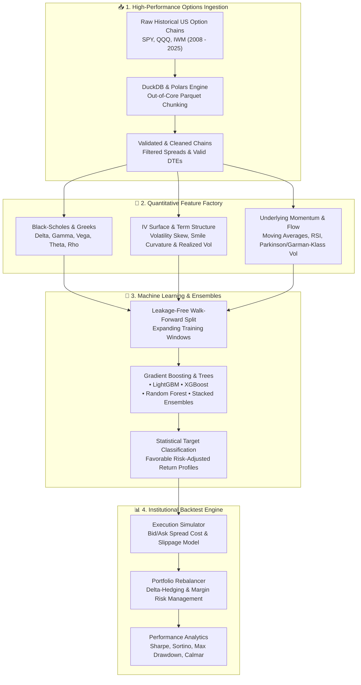

# 📈 US Equity Options Alpha & Machine Learning Prediction Engine

<div align="center">

[](https://www.python.org/)
[](https://scikit-learn.org/)
[](https://duckdb.org/)
[](LICENSE)
[]()

**A production-grade, out-of-core quantitative research and backtesting framework designed to predict statistically favorable US Equity Call/Put option contracts using Implied Volatility Surface dynamics, Greeks, and Walk-Forward Ensembles.**

[Overview](#-overview) • [Architecture](#-system-architecture) • [Feature Engineering](#-feature-engineering--greeks) • [ML Models](#-predictive-modeling--evaluation) • [Project Structure](#-project-structure) • [Getting Started](#-getting-started)

</div>

---

## 📌 Overview

Pricing options efficiently requires navigating high-dimensional non-linear spaces: moneyness, Days to Expiration (DTE), Implied Volatility (IV) skews, term structure dynamics, and higher-order Greeks. Most retail models fail due to severe lookahead bias, bid-ask spread underestimation, and data leakage across maturities.

This repository implements an institutional quantitative workflow for the US Equity Options market (SPY, QQQ, IWM):
- **Out-of-Core Data Engine:** Processes multi-gigabyte historical option chains (2008–2025) efficiently via DuckDB, Polars, and Parquet.
- **Vol Surface & Greek Modeling:** Extracts IV surface curvature, smile dynamics, term structure slope, and Black-Scholes Greeks ($\Delta, \Gamma, \Theta, \mathcal{V}, \rho$).
- **Anti-Leakage Validation:** Enforces strict expanding/rolling **Walk-Forward splits** with zero lookahead bias across underlying assets.
- **Realistic Backtesting Engine:** Models execution slippage, bid-ask friction, margin constraints, and multi-horizon portfolio holding returns.

---

## 🏗️ System Architecture



---

## 🧮 Feature Engineering & Greeks

The feature engine extracts domain-specific quantitative signals across every contract:

1. **Option Microstructure & Greeks:**
   $$\Delta = \frac{\partial V}{\partial S}, \quad \Gamma = \frac{\partial^2 V}{\partial S^2}, \quad \Theta = \frac{\partial V}{\partial t}, \quad \mathcal{V} = \frac{\partial V}{\partial \sigma}$$
   - Log-Moneyness: $m = \ln(S / K)$
   - Normalized Time-to-Maturity: $\tau = \text{DTE} / 365$
2. **Implied Volatility Surface Dynamics:**
   - Volatility Skew: Difference between 25-delta Put IV and 25-delta Call IV ($\text{Skew}_{25\Delta} = \sigma_{put} - \sigma_{call}$)
   - Term Structure Slope: Ratio of front-month IV to back-month IV ($\frac{\sigma_{30d}}{\sigma_{90d}}$)
   - IV vs. Realized Volatility Premium: $\text{IV} - \text{RV}_{20d}$ (Parkinson & Garman-Klass estimators)

---

## 🤖 Predictive Modeling & Evaluation

- **Anti-Overfitting Discipline:** Financial time-series cannot be shuffled randomly. We employ temporal Walk-Forward Cross-Validation:

```
[ Train Window: Year 1-3 ] ---> [ Test: Year 4 ]
      [ Train Window: Year 1-4 ] ---> [ Test: Year 5 ]
            [ Train Window: Year 1-5 ] ---> [ Test: Year 6 ]
```

- **Algorithms:**
  - `LightGBM`: Fast leaf-wise tree growth tailored for large-scale option panels.
  - `XGBoost`: Robust regularized split trees with custom focal loss.
  - `RandomForestClassifier`: Bagging ensemble for low-variance benchmark.
  - `StackedEnsemble`: Meta-learner combining probability predictions.

---

## 📂 Project Structure

```ascii
option_analysis/
├── configs/                     # YAML configuration files (features, models, backtest)
├── src/
│   ├── data/                    # High-throughput data ingestion, validation & joins
│   │   ├── download_real.py     # Options dataset downloader
│   │   ├── loaders.py           # DuckDB/Polars chunked reader
│   │   └── validate.py          # Schema & data integrity checks
│   ├── features/                # Quantitative feature engineering
│   │   ├── iv_surface.py        # Volatility surface & skew calculations
│   │   ├── options.py           # Black-Scholes pricing & Greek derivations
│   │   ├── volatility.py        # Historical, Parkinson & Garman-Klass estimators
│   │   └── build_features.py    # Pipeline coordinator
│   ├── labels/                  # Return horizon & labeling targets
│   ├── models/                  # Machine learning models (LGBM, XGB, RF, Ensemble)
│   ├── evaluation/              # Walk-forward cross-validation & metric reporting
│   └── backtest/                # Execution simulator, portfolio & performance metrics
├── notebooks/                   # Prototyping & exploratory data analysis (EDA)
├── tests/                       # Unit tests & lookahead bias validation
├── requirements.txt             # Project dependencies
└── .gitignore                   # Excludes raw data, checkpoints & logs
```

---

## 🚀 Getting Started

### 1. Prerequisites
- Python 3.10+
- 16GB+ RAM recommended for large out-of-core Parquet analysis

### 2. Installation

```bash
# Clone the repository
git clone https://github.com/huseyin-yigit-ulker/option_analysis.git
cd option_analysis

# Create and activate virtual environment
python3 -m venv venv
source venv/bin/activate  # On Windows: venv\Scripts\activate

# Install dependencies
pip install -r requirements.txt
```

### 3. Usage Pipeline

```bash
# 1. Download sample option chains
python src/data/download_real.py

# 2. Build feature matrix (Greeks, Vol Surface, Underlyings)
python src/features/build_features.py

# 3. Train models with walk-forward validation
python src/models/train_baselines.py

# 4. Run portfolio backtest simulation
python -m src.backtest.engine
```

---

## ⚖️ Disclaimer

*This project is for research and educational purposes only. Options trading involves substantial risk of loss and is not suitable for all investors. Nothing in this repository constitutes investment advice.*

---

<div align="center">
Developed by <a href="https://github.com/huseyin-yigit-ulker">Hüseyin Yiğit Ülker</a>
</div>
